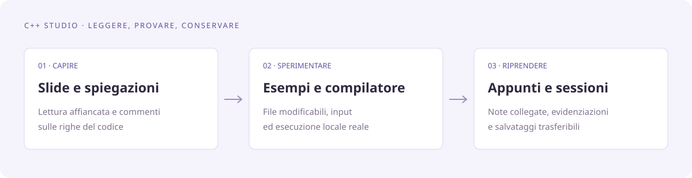

# C++ Studio

**Un ambiente di studio locale che affianca slide, spiegazioni e un vero
compilatore C++, con esempi del docente, appunti contestuali e sessioni
personali trasferibili.**

C++ Studio accompagna il corso *Object oriented programming and C++* dell’Università
di Padova, anno accademico 2025/26. La vista principale presenta ciascuna slide
accanto alla sua spiegazione; i passaggi di codice hanno una lettura guidata e
commenti attivabili sulle righe della slide. I banner lungo il percorso aprono gli
esempi associati dal docente in celle modificabili e compilabili.

Questo repository pubblico contiene il software, le note editoriali, gli strumenti
di ricostruzione e le istruzioni operative. **Non distribuisce la dispensa, le slide,
gli archivi del docente, i cataloghi derivati o le schermate che li riproducono.**
Per usare il corso completo occorre aggiungere localmente le proprie fonti e
rigenerare i contenuti. Il runtime ROOT e le sessioni personali restano locali.

[Inizia dall’avvio locale](#avvio-locale) oppure consulta il
[manuale dell’applicazione](docs/MANUALE.md).

## Da dove iniziare

| Se vuoi… | Parti da qui | Troverai |
|---|---|---|
| Seguire il corso | **Slide e spiegazioni** nell’app | Slide, spiegazione affiancata e lettura del codice |
| Leggere un capitolo senza interruzioni | **Lezione continua** | Testo principale della dispensa, indice e rimandi alle fonti |
| Modificare ed eseguire un programma | **Esempi e laboratori** | File del progetto, compilatore reale, input e risultati |
| Prendere appunti e riprendere il lavoro | **Appunti** e **Sessione** | Evidenziazioni, note collegate alle fonti e salvataggi trasferibili |
| Capire l’implementazione | [Architettura](docs/ARCHITETTURA.md) | Componenti, dati e flusso di compilazione |
| Controllare i risultati delle verifiche | [Verifiche](docs/VERIFICHE.md) | Test, prove nel browser e limiti dichiarati |

## Cosa puoi fare

- Studiare le slide con una spiegazione accanto, senza aprire pannelli per ogni pagina.
- Leggere il testo principale della dispensa in una pagina continua, anche in vista compatta.
- Attivare **Commenti codice** e aprire le note numerate sulle righe delle slide.
- Passare dalla teoria agli esempi mediante banner collocati nei punti indicati dal docente.
- Modificare main, sorgenti e header tramite schede affiancate e compilare il progetto completo.
- Fornire input e argomenti, scegliere lo standard, osservare diagnostiche e scaricare i file prodotti.
- Evidenziare testo e codice, annotare una slide o selezionare una zona di una figura.
- Cercare negli appunti, aggiungere tag, usare preferiti, cestino e ritorno al riferimento.
- Salvare una sessione in JSON e ripristinare file, opzioni, appunti e avanzamento senza account.

Le note editoriali aiutano a leggere gli esempi, mantenendo visibili anche errori
intenzionali, omissioni e differenze fra standard. Una compilazione riuscita non
viene presentata come prova della correttezza generale di un programma.

## Contenuti della configurazione di corso e stato della versione

Le quantità seguenti descrivono la configurazione verificata con i materiali
locali del corso, non file didattici redistribuiti dal repository.

| Elemento | Configurazione verificata |
|---|---:|
| Lezioni | 14 |
| Slide con spiegazione associata | 309 |
| Argomenti nella lettura continua | 322 |
| Blocchi principali della dispensa | 1.431 |
| Commenti contestuali sulle slide | 302 |
| Slide con commenti contestuali | 198 |
| Banner di collegamento agli esempi | 110 |
| Programmi delle lezioni verificati | 192 |
| Test automatici attuali | 41 |

I 192 programmi comprendono **190 compilazioni riuscite** con le ricette o le
varianti documentate e **2 errori didattici attesi**. I 41 test comprendono
29 controlli Python e 12 JavaScript. Le verifiche estese degli esempi e dei
frammenti sono documentate separatamente dai test automatici dell’applicazione.

Il percorso include tutte le slide e il testo principale della dispensa; le
sezioni della dispensa esplicitamente marcate come approfondimento sono escluse
dalla lettura principale. Le lezioni extra su rvalue e concorrenza hanno
spiegazioni dedicate. Gli esercizi e i progetti generali da esame sono conservati
nell’archivio originale ma non fanno parte del percorso interattivo di questa
versione. Le slide originali possono essere in inglese: il progetto non dichiara
una loro traduzione integrale.

## Il percorso di studio

```text
Slide e spiegazione
        |
        v
Lettura del codice e commenti sulle righe
        |
        v
Banner dell’esempio del docente
        |
        v
Modifica dei file -> compilazione reale -> risultati
        |
        v
Appunti collegati e sessione personale
```

La spiegazione rimane accanto alla slide sul computer; sul telefono le due parti
si dispongono in verticale. L’indice permette di raggiungere un punto senza
suddividere la lezione in schermate separate.



## Avvio locale

La configurazione verificata usa **macOS, Python 3.9 o successivo e Clang/GCC**.
Dopo la generazione dei contenuti, il normale utilizzo non richiede pacchetti
Python aggiuntivi, Node.js o servizi cloud. Il compilatore deve essere disponibile nel PATH; su macOS può essere
fornito dai Command Line Tools di Xcode.

```sh
git clone https://github.com/FrancescoBortot/cpp-studio-corso.git
cd cpp-studio-corso
```

Aggiungi la tua copia delle fonti nella struttura descritta in
[materiali/README.md](materiali/README.md). Non vengono scaricate automaticamente.
Per la prima generazione servono `pdftoppm` nel PATH e le dipendenze PDF:

```sh
python3 -m venv .venv
source .venv/bin/activate
python3 -m pip install -r requirements-build.txt
python3 app/tools/build.py
python3 app/server.py
```

Apri [http://127.0.0.1:8765](http://127.0.0.1:8765). Su macOS puoi anche aprire
**Avvia Studio.command** dalla cartella del progetto.

Cataloghi e anteprime vengono creati localmente dalle fonti fornite. Per gli
avvii successivi non serve rigenerarli. Il server ascolta soltanto sull’interfaccia locale
e utilizza `sandbox-exec` per l’esecuzione isolata su macOS. La configurazione di
esecuzione su altri sistemi richiede una verifica specifica; il repository non
promette la stessa protezione su tutte le piattaforme.

### Esempi con ROOT

ROOT è opzionale per il resto del corso. Il server cerca `root-config` nel PATH
oppure un’installazione in `app/.runtime/root`. I binari non sono versionati.

Gli strumenti `download_root.py` e `configure_root.py` documentano il download e
l’adattamento della distribuzione usata sulla macchina di sviluppo. Tale archivio
è specifico per macOS arm64 e non è un installatore universale. Per piattaforme o
SDK diversi occorre usare una distribuzione ROOT compatibile. I dettagli sono nel
[manuale](docs/MANUALE.md#root).

## Sessioni e appunti

Le modifiche dei progetti sono salvate nel browser; gli appunti strutturati usano
IndexedDB. Non serve un account e non avviene sincronizzazione cloud.

| Comando | Conserva |
|---|---|
| **Sessione → Salva sessione** | Tutti i file modificati, file attivo, celle personali, input, argomenti, opzioni del compilatore, appunti e avanzamento |
| **Sessione → Carica sessione** | Ripristino dopo un riepilogo; sostituisce i progetti omonimi e unisce gli appunti conservando i conflitti come copie |
| **Appunti → Backup JSON** | Appunti, evidenziazioni, riferimenti e stato di lettura |
| **Appunti → Esporta Markdown** | Documento leggibile degli appunti attivi |

Un file sessione non include materiali del corso, compilatore, runtime ROOT,
processi in esecuzione o risultati temporanei. Per riprendere su un altro computer
serve una copia compatibile dell’applicazione. I salvataggi personali non vengono
inclusi nei commit del progetto.

## Struttura del repository

```text
cpp-studio-corso/
|-- app/
|   |-- server.py              HTTP locale e API
|   |-- engine.py              compilazione e gestione delle richieste
|   |-- runner.py              esecuzione isolata e limiti
|   |-- web/                   interfaccia; cataloghi e anteprime generati localmente
|   |-- content/               spiegazioni e note editoriali
|   |-- tools/                 generazione e verifiche dei contenuti
|   |-- tests/                 test Python e JavaScript
|   `-- .runtime/              ROOT locale, escluso da Git
|-- materiali/                 istruzioni per aggiungere le fonti locali
|-- docs/                      manuale, architettura, verifiche e diagrammi originali
|-- .local/                    report e cache, esclusi da Git
|-- Avvia Studio.command       avvio rapido su macOS
|-- tools/                     controllo del confine della pubblicazione
|-- Makefile                   comandi di verifica e ricostruzione
|-- requirements-build.txt     dipendenze per rigenerare i contenuti
`-- README.md
```

## Verifica della copia

Dalla radice del progetto, con Python e Node.js 18 o successivo disponibili:

```sh
make check
```

| Comando | Controlla |
|---|---|
| `make check-publication` | Confine dei file pubblici e cronologia Git, con esclusione di fonti e derivati |
| `make check-assets` | Presenza delle fonti, dei cataloghi e delle anteprime; richiede la configurazione locale del corso |
| `make check-course` | Verifica completa, con fonti e cataloghi presenti |
| `make check-python` | Motore e API; copertura e guide vengono aggiunte quando i cataloghi locali sono disponibili |
| `make check-js` | Riferimenti degli appunti e salvataggio/ripristino delle sessioni |
| `make serve` | Avvia il server locale |

Senza materiali, `make check` esegue i controlli del software e segnala esplicitamente
come saltate le verifiche dipendenti dal corso. Con i contenuti generati,
`make check-course` esegue tutti i 41 test della configurazione verificata. Il
repository pubblico non permette di ricostruire il corso completo senza le fonti
locali non distribuite.

Le prove di compilazione eseguono realmente programmi C++ nella sandbox
applicativa. Devono poter aprire un server loopback e avviare la sandbox: una
sandbox esterna più restrittiva può impedirle. I risultati e la distinzione fra
prove automatiche, prove degli esempi e ispezione visuale sono in
[Verifiche](docs/VERIFICHE.md).

## Rigenerare i contenuti

La ricostruzione richiede le dipendenze PDF e `pdftoppm` nel PATH:

```sh
python3 -m venv .venv
source .venv/bin/activate
python3 -m pip install -r requirements-build.txt
python3 app/tools/build.py
```

La pipeline parte dai materiali locali e produce cataloghi, contesti dei listati,
anteprime e guide alle slide. Mantiene distinti i sorgenti del docente, i file di
supporto e le varianti corrette documentate. Le modifiche personali già salvate
nel browser non sono sovrascritte dalla rigenerazione dei cataloghi.

## Documentazione

1. [Manuale dell’applicazione](docs/MANUALE.md)
2. [Architettura e flusso dei dati](docs/ARCHITETTURA.md)
3. [Verifiche e limiti](docs/VERIFICHE.md)
4. [Materiali e provenienza](materiali/README.md)
5. [Contenuto del repository e pubblicazione](docs/PUBBLICAZIONE.md)
6. [Guida ai contributi](CONTRIBUTING.md)

## Provenienza e ambito d’uso

Il materiale didattico è attribuito al corso di P. Ronchese presso l’Università di
Padova. I documenti e gli esempi originali conservano la propria attribuzione e i
diritti dei rispettivi titolari. Il software è uno strumento indipendente di studio; non attribuisce una licenza
di redistribuzione dei materiali e non è una pubblicazione ufficiale dell’università.

Il progetto non adotta ancora una licenza open source per il codice applicativo.
La visibilità pubblica permette di consultare il codice, ma non introduce una
licenza open source implicita. Il confine fra software pubblicato e fonti locali
è descritto in
[Pubblicazione](docs/PUBBLICAZIONE.md).

## Limiti

- Il servizio è personale e locale; non è una piattaforma multiutente per eseguire codice non fidato.
- Gli input vengono forniti prima dell’avvio: l’esecuzione non è un terminale interattivo.
- Alcuni frammenti delle slide richiedono un contesto o un completamento e sono indicati come tali.
- Esempi con comportamento indefinito o concorrenza intenzionalmente errata non hanno un risultato deterministico garantito.
- I commenti aiutano a leggere il codice; non sostituiscono le regole del linguaggio o la verifica delle sue precondizioni.
- Il salvataggio del browser richiede un’esportazione per essere trasferito o recuperato dopo la cancellazione dei dati del sito.
- Il runtime ROOT e le protezioni di esecuzione richiedono un ambiente compatibile.

## Sviluppo assistito

Il progetto è stato sviluppato con assistenza AI per implementazione,
organizzazione dei contenuti e verifiche. Sorgenti, note editoriali, strumenti di
generazione e test sono conservati per rendere ispezionabile il lavoro. I numeri
riportati descrivono la copia verificata e non costituiscono una certificazione
esterna di ogni affermazione delle fonti.

## Autore del progetto

Francesco Bortot
